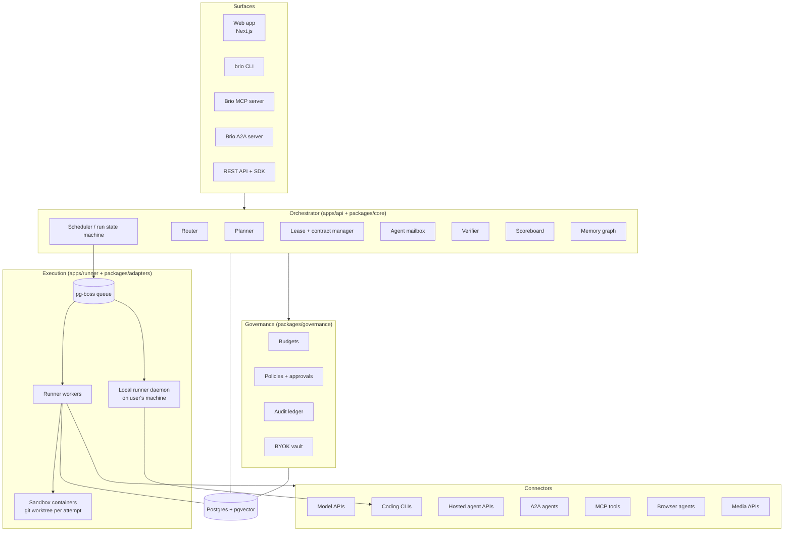
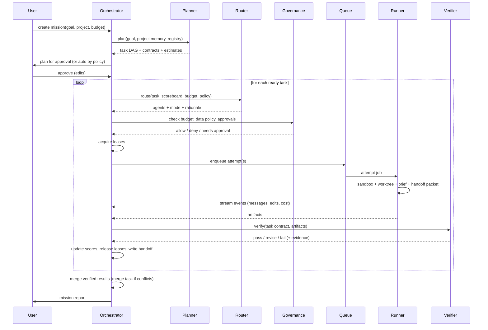

# Brio — Architecture

## 1. Layers



Principle: **the brain decides, runners execute, governance can veto anything, events record everything.**

## 2. Services

| Service | Responsibility | Runs on |
|---|---|---|
| `apps/web` | UI. Talks only to `apps/api` (REST + SSE). | Vercel |
| `apps/api` | Auth, REST, SSE, MCP server, A2A server, orchestrator loop (planner/router/scheduler/verifier calls). Stateless besides DB. | Container (≥2 replicas) |
| `apps/runner` | Pulls attempt jobs, prepares sandbox, invokes adapter, streams events, uploads artifacts. Horizontal scale. | Container host with Docker (or Firecracker later) |
| `apps/cli` | User CLI + `brio runner` local daemon (connects outbound to API over WebSocket, executes jobs tagged `local`). | User machine |
| `apps/evals` | Runs golden missions against Brio and single-agent baselines; writes results. | CI / cron |

## 3. Data model (Drizzle, Postgres)

All tables have `id` (uuid v7), `workspace_id`, `created_at`, `updated_at` unless noted. Soft delete via `deleted_at` where users can delete.

**Tenancy & identity**
- `workspaces` (name, plan, settings jsonb)
- `members` (user_id, workspace_id, role)
- `users`, `sessions`, `accounts` (Better Auth tables)

**Connectors & agents**
- `connectors` — an installed connector: `registry_key` (→ connectors.json id), `display_name`, `route` (api|cli|sdk|hosted|a2a|mcp|browser|local), `credential_ref` (vault id), `config` jsonb, `health` jsonb, `status`.
- `agents` — configured worker: `connector_id`, `model`, `role_prompt`, `tools` jsonb (MCP servers), `limits` jsonb (max tokens, max minutes, max cost), `sandbox_profile`, `tags`, `price_override` jsonb (the user's own price per M tokens), `options` jsonb (vendor request options).
- `connector_models` — the connector's live model list as last fetched: `connector_id`, `model`, `display_name`, `context_tokens`, `max_output_tokens`, `meta`, `listed_at`.
- `model_prices` — public list prices (global, not per workspace): `preset_key`, `model`, `input_per_m`, `output_per_m`, `cached_input_per_m`, `cache_write_per_m`, `long_context` jsonb, `off_peak` jsonb, `currency`, `source` (vendor_docs|openrouter|models_endpoint), `source_url`, `fetched_at`. Every `attempt.cost` event records the price it used.
- `crews` — named sets of agents + routing prefs jsonb.

**Projects & memory**
- `projects` — `kind` (git|files), `repo_url`, `default_branch`, `settings`.
- `memory_nodes` — `project_id`, `kind` (decision|contract|file|preference|fact|task|agent|prompt), `title`, `body`, `embedding vector(1536)`, `source_event_id`.
- `memory_edges` — `from_id`, `to_id`, `kind` (decided_in|implements|touches|prompted_by|supersedes|depends_on).

**Missions**
- `missions` — `project_id`, `title`, `goal`, `status` (draft|planning|awaiting_approval|running|verifying|done|failed|cancelled), `budget` jsonb, `assumptions` jsonb, `report` jsonb.
- `plans` — `mission_id`, `version`, `graph` jsonb (denormalised snapshot), `status`, `approved_by`.
- `plans` — mission plan versions: `version`, `graph` (PlanGraph), `status` (proposed|approved|rejected|superseded), `origin` (planner|user), `lint` jsonb (errors, warnings, automatic fixes, estimate).
- `tasks` — `mission_id`, `plan_version` (0 for the mission's planning task), `key` (stable slug), `type` (taxonomy), `title`, `contract` jsonb (schema `TaskContract`), `depends_on` uuid[], `mode` (single|best_of_n|ensemble|maker_checker|debate|cascade|pipeline), `mode_params` jsonb (the plan's n and pipeline steps; the router's `route` with mode, roles and rationale; the `result` a multi-agent mode chose; once-only `marks`), `pinned_agent_id`, `status` (pending|ready|leased|running|verifying|revise|done|failed|blocked|cancelled), `budget` jsonb, `result_artifact_id`, `revisions` (revise loops used), `blocked_reason`.
- `attempts` — `task_id`, `agent_id`, `role` (maker|checker|candidate|judge|merger), `status`, `sandbox_id`, `worktree_ref`, `started_at`, `ended_at`, `cost_usd numeric(12,6)`, `tokens_in`, `tokens_out`, `exit_reason`, `transcript_ref`, `dispatch` jsonb (what was run), `runner_id`, `heartbeat_at`, `cancel_requested_at`, `checks` jsonb (the verifier's checklist and outcomes).
- `artifacts` — `kind` (diff|file|doc|url|image|video|audio|dataset|report), `storage_ref`, `sha256`, `meta` jsonb, `attempt_id`.
- `blobs` — content-addressed artifact bodies per workspace (`workspace_id`, `sha256`, `content_type`, `size`, `bytes`); `artifacts.storage_ref` is `blob:<sha256>`. Large binaries move to object storage later without changing the ref scheme.
- `reviews` — `task_id`, `attempt_id`, `reviewer_agent_id` or `reviewer_user_id`, `kind` (check|review|judge|human), `verdict` (pass|revise|fail), `scores` jsonb, `reasons` text, `evidence` jsonb.
- `contracts` — shared interface contracts: `project_id`, `name`, `version`, `spec` jsonb or text (OpenAPI, TS types, schema), `owner_task_id`, `status`.
- `leases` — `task_id`, `resource_kind` (path|glob|symbol|contract|external), `resource`, `mode` (exclusive|shared), `expires_at` (heartbeat-renewed), `released_at`.
- `messages` — agent mailbox: `mission_id`, `from_attempt_id`, `to_task_id` or `to_attempt_id` or `to_user`, `kind` (question|answer|review_request|blocker|note), `body`, `status`.
- `handoffs` — `from_task_id`, `to_task_id`, `packet` jsonb (schema `HandoffPacket`).

**Learning**
- `scores` — `scope` (workspace|global), `agent_key` (connector+model), `task_type`, `alpha`, `beta` (Beta posterior for pass), `elo`, `avg_cost`, `p50_latency_s`, `n`, `updated_at`.
- `ratings` — user feedback on attempts.
- `score_history` — one point per score update (pass rate, Elo, n) for the scoreboard's trend lines.

**Governance**
- `budgets` — `scope_kind` (workspace|mission|task|agent), `scope_id`, `limit_usd`, `limit_minutes`, `spent_usd`, `soft_pct`.
- `policies` — `kind` (data_routing|network|approval|connector_allow), `rule` jsonb (evaluated by `packages/governance`).
- `approvals` — `subject_kind`, `subject_id`, `action`, `requested_by`, `status`, `decided_by`, `decided_at`, `reason`.
- `ledger` — append-only, hash-chained: `seq`, `prev_hash`, `hash`, `kind`, `payload` jsonb. No updates or deletes (enforced by trigger).
- `vault_secrets` — `ciphertext`, `dek_wrapped`, `kek_id`, `label`, `last_used_at`.

**Events (the spine)**
- `events` — append-only: `mission_id`, `task_id`, `attempt_id`, `seq` (per mission), `type`, `actor` (system|user:id|agent:id), `payload` jsonb, `ts`. Indexed by (mission_id, seq). The board, scoreboard, ledger and memory ingest all read from here.

Event types (initial): `mission.created`, `plan.proposed`, `plan.edited`, `plan.approved`, `plan.rejected`, `plan.failed`, `mission.started`, `mission.blocked`, `task.ready`, `task.routed`, `task.blocked`, `task.done`, `task.failed`, `lease.granted`, `lease.denied`, `lease.released`, `attempt.queued`, `attempt.started`, `attempt.message`, `attempt.tool_call`, `attempt.file_edit`, `attempt.cost`, `attempt.finished`, `check.result`, `review.verdict`, `judge.verdict`, `handoff.created`, `message.sent`, `message.answered`, `contract.changed`, `budget.warn`, `budget.stop`, `approval.requested`, `approval.decided`, `merge.started`, `merge.conflict`, `merge.done`, `mission.done`, `mission.failed`.

## 4. Core flows

### 4.1 Mission lifecycle



### 4.2 Task state machine

```
pending → ready (deps done) → leased (leases granted) → running → verifying
verifying → done | revise (→ running with same/next agent, max 2) | failed (→ replan proposal)
any → blocked (lease denied / approval pending / budget stop) → ready when cleared
any → cancelled
```
Persist every transition as an event and in `tasks.status`. The scheduler is idempotent: it can crash and resume from DB state.

### 4.3 Attempt execution inside a runner
1. Fetch attempt, agent, connector, decrypted credential (short-lived, in memory only).
2. Create sandbox from `sandbox_profile` (image, CPU, mem, disk, network allowlist, timeout).
3. Check out project into a fresh worktree on branch `brio/<mission>/<task>/<attempt>`.
4. Write `.brio/brief.md` (memory brief) and `.brio/handoff.json` (incoming packets) and `.brio/contract.json` into the worktree.
5. Inject Brio MCP mailbox server config for CLI agents (so they can `ask_agent`, `report_blocker`, `get_contract`).
6. Call `adapter.run(input, ctx)`; translate the adapter's event stream into Brio events.
7. Enforce limits (tokens, cost, time); kill on breach with `exit_reason`.
8. Collect artifacts: git diff, new files, outputs; upload; compute sha256.
9. Tear down sandbox; keep worktree ref for merge.

### 4.4 Merge
Verified attempts' branches are merged in DAG order into `brio/<mission>/integration`. On conflict, Brio creates a `merge` task assigned to the best "merge" agent with both diffs, contracts and handoffs; result goes through verification. Final branch is offered to the user (never pushed automatically; a "push/PR" action requires approval and uses the user's Git credentials).

### 4.5 Brio as MCP server (inbound)
Tools exposed: `delegate(task, constraints)`, `plan_mission(goal)`, `ask_agent(task_key, question)`, `get_brief(paths|topic)`, `report(status, notes)`, `get_contract(name)`, `request_review(artifact)`. OAuth 2.1 for remote clients; local stdio for the local runner.

### 4.6 A2A (both directions)
- Outbound: an `a2a` adapter reads a remote Agent Card, maps its skills to task types, sends tasks, consumes streaming updates and artifacts.
- Inbound: Brio publishes `/.well-known/agent-card.json` describing skills (`plan_and_execute_mission`, `code_change`, `research_report`, …); incoming A2A tasks become missions in the caller's workspace.

## 5. Sandbox profiles (initial)

| Profile | Use | Network | Limits |
|---|---|---|---|
| `code-standard` | coding CLIs | package registries, GitHub, vendor API hosts for that agent | 2 vCPU, 4 GB, 45 min |
| `code-heavy` | builds, e2e | as above + browsers' download hosts | 4 vCPU, 8 GB, 90 min |
| `api-only` | model API calls | vendor API host only | 0.5 vCPU, 512 MB, 15 min |
| `browser` | browser agents | allowlist per task, set by policy | 2 vCPU, 4 GB, 30 min |
| `media` | media APIs | vendor host | 0.5 vCPU, 1 GB, 30 min |

## 6. Scaling and reliability
- API stateless; runners scale on queue depth.
- pg-boss jobs have retry with backoff; attempts are idempotent by `attempt_id`.
- Heartbeats on leases and attempts; reaper releases expired leases and marks dead attempts.
- SSE resumes from `Last-Event-ID` = event seq.
- Rate limits per connector and per workspace (token bucket in Postgres or Redis later).

## 7. Observability
- Structured logs (pino) with mission/task/attempt ids; OpenTelemetry traces across API → queue → runner → vendor call.
- Per-vendor dashboards: error rate, latency, cost.
- Every external call logged as an event with redacted payload.
